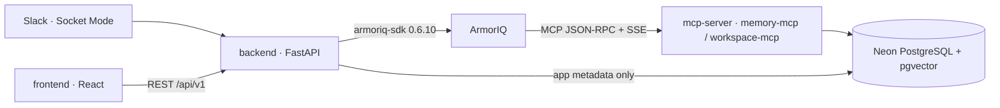

# ProxyLead

A Slack-first AI representative of a busy engineering manager, built for the
ArmorIQ Flow State hackathon (Oct 10–17, 2026). Team members ask what was
decided and why, retrieve authorized team knowledge, and save notes. Every
protected read or action is authorized per requester through ArmorIQ: the
agent never inherits the manager's blanket authority.

> **Status: Phase 0 foundation.** Health endpoints, shared contracts, an app
> shell, and an MCP transport scaffold. **No ArmorIQ experiment has been run**
> (`docs/EXPERIMENTS.md`), and nothing here claims that an ArmorIQ control,
> Slack flow, or agent behavior works yet.

## Architecture



- The **backend** owns trusted identity, orchestration, the ArmorIQ gateway,
  and delivery routing. It never reads protected knowledge directly.
- The **MCP server** is the only component that reads protected knowledge,
  behind tier-specific tools and its own checks.
- The **frontend** shows only real, persisted outcomes.
- Details: `docs/IMPLEMENTATION_CONTRACT.md`. Decisions:
  `docs/ARCHITECTURE_DECISIONS.md` (Neon + pgvector, no Qdrant: ADR-002).

## Stack

| Area | Choice |
|---|---|
| Language | Python 3.12 (backend, MCP server, contracts); TypeScript 6.0 (frontend) |
| Backend | FastAPI 0.143, pydantic-settings, Uvicorn |
| LLM | Anthropic Claude via the official `anthropic` SDK (1.13, not called yet) |
| Authorization | `armoriq-sdk==0.6.10` (pinned; not called yet) |
| Chat | Slack Bolt for Python 1.30, Socket Mode (not wired yet) |
| Tools | Model Context Protocol, official `mcp` SDK 2.3.0 |
| Database | Neon PostgreSQL + pgvector (drivers added with migrations) |
| Frontend | React 19, Vite 8, Vitest 5, ESLint 10 |
| Quality | Ruff 0.17, pytest 9, typescript-eslint, `tsc` |

Exact pins and why: `docs/ARCHITECTURE_DECISIONS.md` (ADR-007, ADR-008).

## Repository layout

| Path | Purpose |
|---|---|
| `backend/` | FastAPI API ([README](backend/README.md)) |
| `frontend/` | Web playground / manager console ([README](frontend/README.md)) |
| `mcp-server/` | MCP tool server ([README](mcp-server/README.md)) |
| `contracts/` | Shared contracts: Pydantic → JSON Schema → TypeScript ([README](contracts/README.md)) |
| `docs/` | Implementation contract, ADRs, workflow, experiment log |
| `scripts/check.sh` | Runs every local check (mirrors CI) |
| `.github/workflows/ci.yml` | CI: contracts, backend, MCP server, frontend |
| `ProxyLead_PRD_v2.md` | Authoritative product requirements |
| `ProxyLead_Architecture_v2.1.md` | Authoritative architecture / implementation contract |
| `ProxyLead_Day1_Experiments.md` | ArmorIQ experiment procedures (E1–E5, E17) |

## Local setup

Prerequisites: Python 3.12 (3.13 also works locally), Node.js ≥ 22.12, Git.

```bash
cp .env.example .env            # optional for the foundation; fill in later phases

# backend (also hosts the contracts package for local contract checks)
cd backend
python -m venv .venv
.venv/Scripts/python -m pip install -e ../contracts/python -e ".[dev]"   # macOS/Linux: .venv/bin/python
cd ..

# MCP server
cd mcp-server
python -m venv .venv
.venv/Scripts/python -m pip install -e ../contracts/python -e ".[dev]"
cd ..

# frontend
cd frontend && npm ci && cd ..
```

## Run

```bash
# terminal 1: backend on :8000
cd backend && .venv/Scripts/uvicorn app.main:create_app --factory --reload --port 8000

# terminal 2: MCP server on :8100 (needs TOOLSERVER_BEARER_* in .env to accept MCP calls)
cd mcp-server && .venv/Scripts/uvicorn app.main:create_app --factory --port 8100

# terminal 3: frontend on :5173
cd frontend && npm run dev
```

Open http://localhost:5173. The header shows the live backend health.

## Configuration

All variables are documented in `.env.example` (root, for the backend and MCP
server) and `frontend/.env.example` (`VITE_*` only, public by design). No
secret is needed to start the apps or run the tests. Never commit `.env`.

## Checks

```bash
bash scripts/check.sh
```

This runs Ruff lint/format, contract schema drift, pytest for contracts,
backend, and MCP server, then frontend type generation drift, ESLint,
`tsc`, Vitest, and the production build. CI
(`.github/workflows/ci.yml`) runs the same on Python 3.12 / Node 22 without
secrets. Per-app commands are in each app's README and
`docs/DEVELOPMENT_WORKFLOW.md`.

## Phases

1. **Phase 0 — foundation** (this state).
2. **Phases 1–4** follow the separate implementation plan, starting with the
   live ArmorIQ experiments (E1 real call path, E3 per-member outcomes) before
   any product UI. See `docs/DEVELOPMENT_WORKFLOW.md`.

## Security guardrails (apply from the first line of feature code)

Protected reads and actions go through ArmorIQ and the MCP server; the
backend owns identity and routing; user-supplied identity, tier, or
permission is never an authorization control; tool names plus server-side
code enforce the tier; confidential/restricted answers are DM-only; fail
closed; real ArmorIQ approvals only; retrieved content is untrusted;
credentials stay out of logs and Git; no control is claimed until tested.
Full list: `docs/IMPLEMENTATION_CONTRACT.md` §5.
