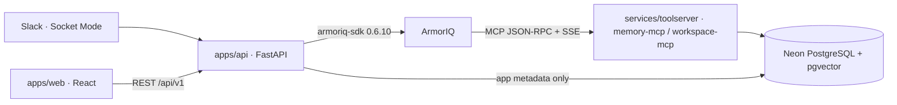

# ProxyLead

A Slack-first AI representative of a busy engineering manager, built for the
ArmorIQ Flow State hackathon (Oct 10–17, 2026). Team members ask what was
decided and why, retrieve authorized team knowledge, and save notes. Every
protected read or action is authorized per requester through ArmorIQ: the
agent never inherits the manager's blanket authority.

> **Status: Phase 0 foundation.** Health endpoints, shared contracts, an app
> shell, and an MCP transport scaffold. **No ArmorIQ experiment has been run**
> (`docs/EXPERIMENTS.md`), and nothing here claims that an ArmorIQ control,
> Slack flow, or agent behavior works yet.

## Architecture



- **`apps/api`** owns trusted identity, orchestration, the ArmorIQ gateway
  (`services/authorization`), and delivery routing. It never reads protected
  knowledge directly.
- **`services/toolserver`** is the only component that reads protected
  knowledge (`services/knowledge`), behind tier-specific tools and its own checks.
- **`apps/web`** shows only real, persisted outcomes.
- Details: `docs/IMPLEMENTATION_CONTRACT.md`. Decisions:
  `docs/ARCHITECTURE_DECISIONS.md` (Neon + pgvector, no Qdrant: ADR-002;
  repository layout: ADR-013).

## Stack

| Area | Choice |
|---|---|
| Language | Python 3.12 (`apps/api`, `services/*`); TypeScript 6.0 (`apps/web`) |
| API | FastAPI 0.143, pydantic-settings, Uvicorn |
| LLM | Anthropic Claude via the official `anthropic` SDK (1.13, not called yet) |
| Authorization | `armoriq-sdk==0.6.10` (pinned; not called yet) |
| Chat | Slack Bolt for Python 1.30, Socket Mode (not wired yet) |
| Tools | Model Context Protocol, official `mcp` SDK 2.3.0 |
| Database | Neon PostgreSQL + pgvector (drivers added with migrations) |
| Web | React 19, Vite 8, Vitest 5, ESLint 10 |
| Quality | Ruff 0.17, pytest 9, typescript-eslint, `tsc` |

Exact pins and why: `docs/ARCHITECTURE_DECISIONS.md` (ADR-007, ADR-008).

## Repository layout

Follows `ProxyLead_PRD_v2.md` §3.1 and `ProxyLead_Architecture_v2.1.md` §11.

| Path | Purpose |
|---|---|
| `apps/api/` | FastAPI API ([README](apps/api/README.md)) |
| `apps/web/` | Web playground / manager console ([README](apps/web/README.md)) |
| `services/toolserver/` | MCP tool server, deployed separately ([README](services/toolserver/README.md)) |
| `services/contracts/` | Shared contracts: Pydantic → JSON Schema → TypeScript ([README](services/contracts/README.md)) |
| `services/authorization/` | ArmorIQ gateway (placeholder; the only `armoriq_sdk` importer) |
| `services/slack_socket/` | Slack Socket Mode adapter (placeholder) |
| `services/knowledge/` | Retrieval, callable only by the tool server (placeholder) |
| `services/audit/` | Request/decision/delivery audit (placeholder) |
| `tests/` | `tests/api/`, `tests/toolserver/`, `tests/contracts/` |
| `scripts/check.sh` | Runs every local check (mirrors CI) |
| `docs/` | Implementation contract, ADRs, workflow, experiment log |
| `pyproject.toml` | One Python project (`proxylead`) with `api` / `toolserver` / `dev` extras |
| `.github/workflows/ci.yml` | CI: lint + contracts, apps/api, services/toolserver, apps/web |
| `ProxyLead_PRD_v2.md` | Authoritative product requirements |
| `ProxyLead_Architecture_v2.1.md` | Authoritative architecture / implementation contract |
| `ProxyLead_Day1_Experiments.md` | ArmorIQ experiment procedures (E1–E5, E17) |

`migrations/`, `seed/`, `policy/` and the documented scripts are added in
the phases that give them content.

## Local setup

Prerequisites: Python 3.12 (3.13 also works locally), Node.js ≥ 22.12, Git.
All commands run from the repository root.

```bash
cp .env.example .env                                  # optional for the foundation
python -m venv .venv
.venv/Scripts/python -m pip install -e ".[api,toolserver,dev]"   # macOS/Linux: .venv/bin/python
(cd apps/web && npm ci)
```

A deployment installs only what it runs: `pip install ".[api]"` for the API,
`pip install ".[toolserver]"` for the MCP tool server.

### Run with Docker

Prefer containers over a hand-built toolchain: [`docs/DOCKER.md`](docs/DOCKER.md)
starts the API, tool server, web dev server, and a local pgvector Postgres
with `docker compose up --build -d` — no local Python/Node/Postgres required.

## Run

```bash
# terminal 1: API on :8000
.venv/Scripts/uvicorn apps.api.main:create_app --factory --reload --port 8000

# terminal 2: MCP tool server on :8100 (needs TOOLSERVER_BEARER_* in .env to accept MCP calls)
.venv/Scripts/uvicorn services.toolserver.main:create_app --factory --port 8100

# terminal 3: web app on :5173
cd apps/web && npm run dev
```

Open http://localhost:5173. The header shows the live API health.

## Configuration

All variables are documented in `.env.example` (root, read by `apps/api` and
`services/toolserver`) and `apps/web/.env.example` (`VITE_*` only, public by
design). No secret is needed to start the apps or run the tests. Never commit
`.env`.

## Checks

```bash
bash scripts/check.sh
```

This runs Ruff lint/format, contract schema drift, pytest for
`tests/contracts`, `tests/api` and `tests/toolserver`, then web type-generation
drift, ESLint, `tsc`, Vitest, and the production build. CI
(`.github/workflows/ci.yml`) runs the same on Python 3.12 / Node 22 without
secrets, installing the `api` and `toolserver` extras in separate jobs to prove
their dependency isolation. More commands: `docs/DEVELOPMENT_WORKFLOW.md`.

## Phases

1. **Phase 0 — foundation** (this state).
2. **Phases 1–4** follow the separate implementation plan, starting with the
   live ArmorIQ experiments (E1 real call path, E3 per-member outcomes) before
   any product UI. See `docs/DEVELOPMENT_WORKFLOW.md`.

## Security guardrails (apply from the first line of feature code)

Protected reads and actions go through ArmorIQ and the MCP server; the
backend owns identity and routing; user-supplied identity, tier, or
permission is never an authorization control; tool names plus server-side
code enforce the tier; confidential/restricted answers are DM-only; fail
closed; real ArmorIQ approvals only; retrieved content is untrusted;
credentials stay out of logs and Git; no control is claimed until tested.
Full list: `docs/IMPLEMENTATION_CONTRACT.md` §5.
