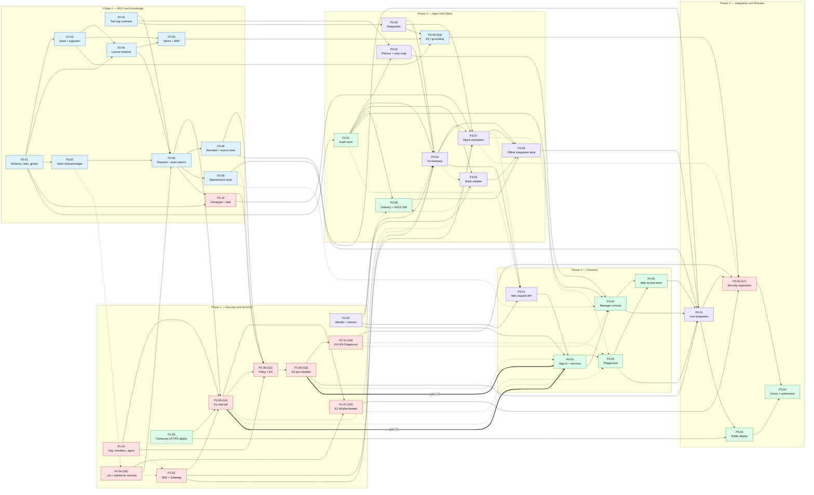

# ProxyLead implementation plan (`docs/Todos`)

This is the task breakdown for building ProxyLead after the Phase 0 scaffold
(commit `5e97604`). It is **planning only**: nothing here is implemented yet.

**Authoritative sources:** `ProxyLead_PRD_v2.md` (PRD) and
`ProxyLead_Architecture_v2.1.md` (Arch). Every task cites the sections it
implements. Conflicts and open questions are tracked in
[context/DECISIONS_AND_OPEN_QUESTIONS.md](context/DECISIONS_AND_OPEN_QUESTIONS.md),
not resolved silently.

## How to use this plan

1. Everyone reads [context/PROJECT_CONTEXT.md](context/PROJECT_CONTEXT.md),
   [context/ARCHITECTURE_RULES.md](context/ARCHITECTURE_RULES.md),
   [context/SHARED_INTERFACES.md](context/SHARED_INTERFACES.md) and
   [context/AGENT_HANDOFF_PROTOCOL.md](context/AGENT_HANDOFF_PROTOCOL.md).
2. Pick your task from the index below. Read its phase README and the task file (17 sections).
3. Before starting, check its hard dependencies (merged?) and the decisions it is blocked by.
4. Work on one branch with one PR per task. Post the handoff report (protocol §7). Do not merge your own PR; the merger follows the [PR merge order](#pr-merge-order).
5. Testing: after each merge wave, run its checkpoint from [CHECKPOINTS.md](CHECKPOINTS.md) (issues #40–#47) before merging the next wave.
6. GitHub issues: every task is an issue (#2–#39) and every checkpoint too (#40–#47). Progress = issue assignees, PRs and closed issues. Mapping: [GITHUB_ISSUES.md](GITHUB_ISSUES.md).

## Status snapshot (14 Oct 2026)

- Scaffold complete: health endpoints, contracts, MCP transport, web shell, CI ([PROJECT_CONTEXT §7](context/PROJECT_CONTEXT.md)).
- **No ArmorIQ experiment has run** (E1–E5, E17 = NOT RUN). The documented Day-1 gates (13 Oct) have slipped, so this plan compresses 14–17 Oct.
- **Resolved 14 Oct 2026** (ADR-015 to ADR-028): D-01 (tool module names), D-08 (`psycopg` 3 + SQL migrations), D-19, D-07 (Render), D-02, D-18, D-03, D-04, D-20, D-26, D-12, D-17, D-29, the ArmorIQ policy evidence set, and D-25 (no assignments; contributors self-assign).
- Still open:
  - ArmorIQ Org Admin access and the API key (`Aditya-Rawat01`, tracked in P1-01 / #2).
- Participants: `Aditya-Rawat01` acts as Maya (Org Admin, console approver, host); the team picks Sam and Priya from `samarth-chawla`, `VTCodeCraft`, `parthgoyal26-03-2005`. Blocker issue #1 is closed.

## Phases

| Phase | Focus | Tasks | Main owner(s) | README |
|---|---|---|---|---|
| 1 — Security and ArmorIQ | Org setup, gateway, identity, `_ctx`, policy, E1–E5 gates | 10 | `samarth-chawla` | [Phase-1](Phase-1-Security-ArmorIQ/README.md) |
| 2 — MCP and Knowledge | Schema/roles, seed, retrieval, 14 tools, ledger | 10 | `Aditya-Rawat01` | [Phase-2](Phase-2-MCP-Knowledge/README.md) |
| 3 — Agent and Slack | Audit store, planner, responder, orchestrator, Slack, delivery, hijack mode, E17 | 9 | `VTCodeCraft`, `parthgoyal26-03-2005` | [Phase-3](Phase-3-Agent-Slack/README.md) |
| 4 — Frontend | Web request API, sign-in, playground, manager console, access tests | 5 | `parthgoyal26-03-2005` | [Phase-4](Phase-4-Frontend/README.md) |
| 5 — Integration and Release | Live integration, security regression, deploy, demo, submission | 4 | all | [Phase-5](Phase-5-Integration-Release/README.md) |
| **Total** | | **38** | | |

Phases are **workstreams with gates, not strict sequences**. E1 (Phase 1)
needs the first product tool (Phase 2), and the UI (Phase 4) waits for the
Phase 1 gates.

## Security gates

| Gate | Check | Task | Unlocks |
|---|---|---|---|
| G0 | `_ctx` + credential verification merged; backend DB role denied protected reads | P1-04, P2-01 | Deploying any product tool |
| G1 | **E1** real call reaches MCP with a correlated ledger row | P1-06 | Real-gateway orchestrator merge; E2/E5; UI (with G3) |
| G2 | **E5** policy accepted; names verified; mismatch fails closed | P1-08 | E3 |
| G3 | **E3** live per-member matrix; no identity leakage | P1-09 | **Phase 4 UI start** (with G1); P5-01 |
| G4 | **E4** console approval → resume; reject/timeout/expiry/duplicate fail closed | P1-10 | Presenting a working approval demo (otherwise show "pending/unverified") |
| G5 | **E2** off-plan/tamper enforcement layers recorded | P1-07 | Showing honeypot/off-plan enforcement labels |
| G6 | **E17** grounding evaluation; `MIN_SCORE` calibrated | P3-08 | Grounding/abstention claims |
| G7 | Arch §13 security tests pass (core by 16 Oct 12:00) | P5-02 | Final demo; any stretch work |

The Arch §12 build gate (E1 + E3 before the full implementation) is respected.
Under D-19 (PROPOSED, needs team confirmation), backend modules that do not
depend on unverified ArmorIQ behavior may be built against fakes before then.

## Task index

| ID | Title | Owner | Phase |
|---|---|---|---|
| [P1-01](Phase-1-Security-ArmorIQ/P1-01-armoriq-org-members-and-agent-setup.md) | ArmorIQ organization, members, and agent setup | `samarth-chawla` | 1 |
| [P1-02](Phase-1-Security-ArmorIQ/P1-02-armoriq-sdk-verification-and-gateway.md) | ArmorIQ SDK surface verification and `ArmorIQGateway` | `samarth-chawla` | 1 |
| [P1-03](Phase-1-Security-ArmorIQ/P1-03-trusted-identity-and-web-session.md) | Trusted identity mapping and web demo session | `VTCodeCraft` | 1 |
| [P1-04](Phase-1-Security-ArmorIQ/P1-04-signed-ctx-and-toolserver-request-security.md) | Signed `_ctx` envelope and tool-server request security | `samarth-chawla` | 1 |
| [P1-05](Phase-1-Security-ArmorIQ/P1-05-toolserver-public-https-experiment-deployment.md) | Tool-server public HTTPS deployment for experiments | `parthgoyal26-03-2005` | 1 |
| [P1-06](Phase-1-Security-ArmorIQ/P1-06-e1-real-call-reaches-mcp.md) | E1: a real planned tool call reaches the MCP server through ArmorIQ | `samarth-chawla` | 1 |
| [P1-07](Phase-1-Security-ArmorIQ/P1-07-e2-off-plan-and-tamper.md) | E2: off-plan and tampered invocation behavior | `samarth-chawla` | 1 |
| [P1-08](Phase-1-Security-ArmorIQ/P1-08-policy-and-e5-setup-conformance.md) | ArmorIQ policy and E5 setup/policy conformance | `samarth-chawla` | 1 |
| [P1-09](Phase-1-Security-ArmorIQ/P1-09-e3-per-member-outcomes.md) | E3: different outcomes for different members on the same tool | `samarth-chawla` | 1 |
| [P1-10](Phase-1-Security-ArmorIQ/P1-10-e4-hold-approval-resume.md) | E4: HOLD → console approval → resume (and every failure path) | `samarth-chawla` | 1 |
| [P2-01](Phase-2-MCP-Knowledge/P2-01-database-schema-migrations-and-roles.md) | Neon schema, migrations, database roles, and grant verification | `Aditya-Rawat01` | 2 |
| [P2-02](Phase-2-MCP-Knowledge/P2-02-tool-argument-and-result-contracts.md) | Tool argument and result contracts | `Aditya-Rawat01` | 2 |
| [P2-03](Phase-2-MCP-Knowledge/P2-03-seed-corpus-ingestion-and-embeddings.md) | Synthetic seed corpus, ingestion, and local embeddings | `Aditya-Rawat01` | 2 |
| [P2-04](Phase-2-MCP-Knowledge/P2-04-lexical-retrieval-and-tier-filters.md) | Lexical retrieval with hard-coded tier filters | `Aditya-Rawat01` | 2 |
| [P2-05](Phase-2-MCP-Knowledge/P2-05-vector-retrieval-and-rank-fusion.md) | Vector retrieval and reciprocal rank fusion | `Aditya-Rawat01` | 2 |
| [P2-06](Phase-2-MCP-Knowledge/P2-06-memory-mcp-wiring-and-team-search.md) | `memory-mcp` product-tool wiring and `knowledge_search_team` | `Aditya-Rawat01` | 2 |
| [P2-07](Phase-2-MCP-Knowledge/P2-07-hash-chained-execution-ledger.md) | Hash-chained execution ledger, verifier, and `jti` idempotency | `Aditya-Rawat01` | 2 |
| [P2-08](Phase-2-MCP-Knowledge/P2-08-elevated-tier-and-source-read-tools.md) | Elevated-tier search and source-read tools | `Aditya-Rawat01` | 2 |
| [P2-09](Phase-2-MCP-Knowledge/P2-09-knowledge-maintenance-tools.md) | Knowledge maintenance tools (drafts, Maya confirmation, supersession) | `Aditya-Rawat01` | 2 |
| [P2-10](Phase-2-MCP-Knowledge/P2-10-workspace-mcp-honeypot-and-followup-task.md) | `workspace-mcp`: `send_external_message` honeypot and optional `create_followup_task` | `samarth-chawla` | 2 |
| [P3-01](Phase-3-Agent-Slack/P3-01-request-audit-and-state-persistence.md) | Request, plan, decision, approval, and delivery persistence (`services/audit`) | `parthgoyal26-03-2005` | 3 |
| [P3-02](Phase-3-Agent-Slack/P3-02-planner-plan-validation-and-topic-map.md) | Planner, plan validation, and topic-map tier selection | `VTCodeCraft` | 3 |
| [P3-03](Phase-3-Agent-Slack/P3-03-grounded-responder-and-citation-validation.md) | Grounded responder, citation validation, and abstention | `VTCodeCraft` | 3 |
| [P3-04](Phase-3-Agent-Slack/P3-04-request-orchestrator.md) | Request orchestrator (one plan per request, end to end) | `VTCodeCraft` | 3 |
| [P3-05](Phase-3-Agent-Slack/P3-05-slack-socket-mode-adapter.md) | Slack Socket Mode adapter (mentions, DMs, dedupe, `store this`) | `VTCodeCraft` | 3 |
| [P3-06](Phase-3-Agent-Slack/P3-06-delivery-routing-and-hold-notification.md) | Safe delivery routing and HOLD notification | `parthgoyal26-03-2005` | 3 |
| [P3-07](Phase-3-Agent-Slack/P3-07-hijacked-model-simulation.md) | "Simulate hijacked model" mode and honeypot attempt routing | `VTCodeCraft` | 3 |
| [P3-08](Phase-3-Agent-Slack/P3-08-e17-grounding-evaluation.md) | E17: grounding evaluation and `MIN_SCORE` calibration | `Aditya-Rawat01` | 3 |
| [P3-09](Phase-3-Agent-Slack/P3-09-agent-integration-and-injection-tests.md) | Agent integration, prompt-injection, and failure-mode tests (offline) | `VTCodeCraft` | 3 |
| [P4-01](Phase-4-Frontend/P4-01-web-request-api.md) | Web request API (submit message, poll status) | `VTCodeCraft` | 4 |
| [P4-02](Phase-4-Frontend/P4-02-frontend-foundation-session-and-api-client.md) | Frontend foundation: sign-in, session state, typed API client | `parthgoyal26-03-2005` | 4 |
| [P4-03](Phase-4-Frontend/P4-03-team-web-playground.md) | Team member web playground | `parthgoyal26-03-2005` | 4 |
| [P4-04](Phase-4-Frontend/P4-04-manager-console-and-audit-view.md) | Manager console and audit view (API + UI) | `parthgoyal26-03-2005` | 4 |
| [P4-05](Phase-4-Frontend/P4-05-frontend-tests-and-access-control.md) | Frontend tests and web access-control verification | `parthgoyal26-03-2005` | 4 |
| [P5-01](Phase-5-Integration-Release/P5-01-cross-service-integration.md) | Cross-service integration and live end-to-end vertical slice | `VTCodeCraft` | 5 |
| [P5-02](Phase-5-Integration-Release/P5-02-end-to-end-security-regression.md) | End-to-end security regression (Arch §13, SC-01..SC-06) | `samarth-chawla` | 5 |
| [P5-03](Phase-5-Integration-Release/P5-03-deployment-and-configuration.md) | Public demo deployment and configuration | `parthgoyal26-03-2005` | 5 |
| [P5-04](Phase-5-Integration-Release/P5-04-demo-and-submission.md) | Demo script, README claims, video, and submission | `parthgoyal26-03-2005` | 5 |

Dependencies, sizes, and gates per task are in each phase README and task file (§5, §16).

## Dependency graph

Generated from the "Depends on" lines (§16) of the task files.

- Solid arrow = hard dependency (must be merged first).
- Dotted arrow = soft dependency (interface-first; use the agreed interface plus a fake).
- Thick arrow = gate.

Colors show the owner: red `samarth-chawla`, blue `Aditya-Rawat01`, purple
`VTCodeCraft`, green `parthgoyal26-03-2005`.



## Critical path

The longest gated chain determines the earliest finish:

```text
P2-01 schema → P2-03 seed → P2-04 lexical retrieval ─┐
P2-07 ledger ───────────────────────────────────────┤
P1-04 _ctx security (G0) ───────────────────────────┼→ P2-06 first tool → P1-06 E1 (G1)
P1-05 HTTPS deploy ─────────────────────────────────┘          │
          P2-08, P2-10 (after P2-06; P2-09 soft) ───────────────┴→ P1-08 E5 (G2) → P1-09 E3 (G3)
   → P4-02 → P4-03 / P4-04 → P4-05 → P5-01 → P5-02 (G7, core by 16 Oct 12:00) → P5-04 submit
```

Everything that blocks E1 must start **today**: P2-01, P2-02, P2-03, P2-07,
P1-04, P1-05, P1-01, P1-02. P1-06 → P1-10 are serialized live runs by one
owner. Protect that owner's time.

## Parallelization plan (target windows)

| Window | `samarth-chawla` | `Aditya-Rawat01` | `VTCodeCraft` | `parthgoyal26-03-2005` |
|---|---|---|---|---|
| 14 Oct (today) | P1-01, P1-02, P1-04; draft the P1-08 YAML | P2-02 (first), P2-01, P2-07, P2-03 increment 1 | P1-03; P3-03 after P2-02 | Decide D-07 → P1-05; P3-01 after P2-01 |
| 15 Oct AM | P1-06 E1 → P1-07 E2; P2-10 | P2-04 → P2-06 → P2-08 | P3-02, P3-04 (fakes) | P3-06; P1-05 redeploy |
| 15 Oct PM | P1-08 E5 → P1-09 E3 → P1-10 E4 | P2-09, P2-05, P2-03 full corpus | P3-05; P3-04 real gateway (after G1); P4-01 | After G1 + G3: P4-02 → P4-03 |
| 16 Oct AM (freeze 12:00) | P5-02 core security tests | P3-08 E17 | P3-07, P3-09, P5-01 | P4-04, P4-05; prepare P5-03 |
| 16 Oct PM | P5-02 remainder | Fixes | Fixes; `docs/ARCHITECTURE.md` | P5-03 deploy; rehearse 3× (P5-04) |
| 17 Oct | Critical fixes only | Critical fixes only | Critical fixes only | P5-04 record + submit (deadline per D-24) |

## PR merge order

Contributors open PRs; only the designated merger merges them, one at a time,
in the order below. Work proceeds in **waves**. A wave's tasks are built in
parallel from an up-to-date `main`. The whole wave is merged in order before
the next wave branches. Waves follow hard dependencies, not phase numbers,
because Phase 1's live experiments need Phase 2 tools (see Critical path).

### Before Wave 1

- [ ] All local planning and scaffold commits are pushed to `origin/main`. Contributors must branch from a `main` that contains `docs/Todos/`.
- [ ] The merger has write or maintain access. The repository owner may protect `main`: require a PR, require passing CI, require the branch to be up to date before merging, restrict who can merge.
- [ ] Interfaces used across PRs in the same wave are agreed before coding (SHARED_INTERFACES.md, ICR per AGENT_HANDOFF_PROTOCOL.md §4). Wave 1 needs `sign_ctx` / `verify_tool_call` (P1-04, used by P1-02 and later P2-06) and decision D-04.
- [ ] Decisions that block the wave's tasks are resolved (task file §5).

### Merge sequence

Issue numbers are shown in parentheses (`#n`); every task has exactly one issue.

Merge left to right within a wave. "Needs" lists the earlier items of the
**same** wave that must merge before that PR can be finished and rebased. The
author may build on the other PR's branch meanwhile (stacked PR), but that PR
merges first.

| Wave | Merge order | Needs (same wave) | Notes |
|---|---|---|---|
| 1 — Phase 1 setup | P1-01 (#2) → P1-04 (#5) → P1-03 (#4) → P1-02 (#3) → P1-05 (#6) | — | All independent. P1-04 first: the gateway and every tool depend on it. P1-03 is the first contract-changing PR. P1-02 rebases onto the real `sign_ctx`. P1-05 deploys the scaffold only |
| 2 — Data and contracts | P2-02 (#12) → P2-01 (#13) | — | The P1-08 policy YAML may be drafted now; its PR merges in Wave 6 |
| 3 — Data layer | P2-07 (#14) → P2-03 (#15) → P3-01 (#16) → P3-03 (#17) | — | P2-03 ships the E1 seed record first |
| 4 — First tool | P2-04 (#18) → P2-06 (#19) → P3-02 (#20) → P2-05 (#21) | P2-06 and P2-05 need P2-04 | After P2-06 merges, redeploy the tool server (P1-05 procedure). P1-04 must already be merged (G0) |
| 5 — E1 and remaining tools | P1-06 (#7) → P2-08 (#22) → P2-10 (#23) → P2-09 (#24) → P3-04 (#25) → P3-05 (#26) → P3-06 (#27) → P1-07 (#8) | P3-04 and P1-07 need P1-06; P2-09 needs P2-08 (same tools module) | P1-06 (E1) merges only with its live record. P3-04's real-gateway wiring merges after G1. Redeploy after P2-08/P2-10/P2-09 |
| 6 — Gates | P1-08 (#9) → P1-09 (#10) → P1-10 (#11) → P3-07 (#28) → P4-01 (#29) → P3-08 (#30) | P1-09 needs P1-08; P1-10 needs P1-09 | E5 → E3 → E4, one live run each, records included. P4-01 is backend; UI waits for G1 + G3 |
| 7 — UI and offline suites | P4-02 (#31) → P4-03 (#32) → P4-04 (#33) → P4-05 (#34) → P3-09 (#35) | P4-03 and P4-04 need P4-02; P4-05 needs both | Starts only after G1 (P1-06) and G3 (P1-09) passed or fallbacks are recorded |
| 8 — Release | P5-01 (#36) → P5-03 (#37) → P5-02 (#38) → P5-04 (#39) | P5-02 and P5-03 need P5-01; P5-04 needs both | P5-02 core items by 16 Oct 12:00 (freeze) |

**Testing checkpoint after every wave:** when a wave is fully merged, run its checkpoint on the integrated `main` (Wave 1 → CP-1 #40, Wave 2 → CP-2 #41, … Wave 8 → CP-8 #47). The next wave's PRs are not merged until it passes. Commands, live checks and pass criteria are in [CHECKPOINTS.md](CHECKPOINTS.md); each checkpoint issue is closed only when it passes.

This order was validated against every task's hard dependencies, the G1/G3
gates, and same-file sequences: 38 tasks, no violations.

### Per-PR merge procedure

1. `git checkout main && git pull`.
2. The author (or merger) rebases the PR branch on `main` and resolves conflicts (rules below).
3. Green CI on the rebased branch, or `bash scripts/check.sh` locally.
4. Review the diff against the task file: only files from §6/§7 are touched, the §10 acceptance criteria are met, and the §11 tests are present. Required steward reviews are done (AGENT_HANDOFF_PROTOCOL.md §3).
5. Live-experiment PRs (P1-06..P1-10, P3-08) include their `docs/EXPERIMENTS.md` record from a real run. Mocked runs never pass a gate.
6. Merge, then go to the next PR in the sequence. Never merge two PRs from the same wave without rebasing the second on the first.

### Conflict rules

- **Generated files** (`services/contracts/schemas/*.json`, `apps/web/src/types/generated/*`): never hand-merge. Rebase, then regenerate with `python -m services.contracts.schema_export --write` and `cd apps/web && npm run gen:types`.
- **Steward files** (`services/contracts/*.py`, `apps/api/routes/router.py`, `apps/api/main.py`, `pyproject.toml`, `services/toolserver/{main,config,servers}.py`): keep both sides' additions; the steward reviews.
- **Migrations:** if two PRs add the same migration number, renumber the later one at merge time. Never edit a merged migration.
- **`docs/SECURITY.md` and `docs/EXPERIMENTS.md`:** sections are appended; the later PR appends after the earlier one.
- A PR that would deploy a product tool before P1-04 is merged is not merged (G0).

## Owner allocation

| Owner | Tasks | Rough effort* | Focus |
|---|---|---|---|
| `samarth-chawla` | P1-01, P1-02, P1-04, P1-06, P1-07, P1-08, P1-09, P1-10, P2-10, P5-02 (10) | ~34 h | ArmorIQ, gates, `_ctx`, honeypot, security regression |
| `Aditya-Rawat01` | P2-01 … P2-09, P3-08 (10) | ~32 h | Database, retrieval, tools, ledger, E17 |
| `VTCodeCraft` | P1-03, P3-02, P3-03, P3-04, P3-05, P3-07, P3-09, P4-01, P5-01 (9) | ~36 h | Identity, agent pipeline, Slack, web request API, integration |
| `parthgoyal26-03-2005` | P1-05, P3-01, P3-06, P4-02, P4-03, P4-04, P4-05, P5-03, P5-04 (9) | ~32 h | Deployment, audit store, delivery, web UI, demo |

\* Agent-assisted estimates: S ≈ 1.5 h, S–M ≈ 2.5 h, M ≈ 3.5 h, M–L ≈ 5 h, L ≈ 6.5 h. The total (~134 h) is close
to the team's remaining capacity. **Schedule risk is high.** Under pressure, cut
stretch scope and the optional `create_followup_task` (D-17) first. Never cut
the authorization boundary (Arch §18).

**Ownership notes (D-25):**

- The security owner's handle is `samarth-chawla`, confirmed by the project owner on 14 Oct 2026 (`amarth-chawla` in the brief was a typo).
- **Issues are never assigned.** Contributors self-assign when they pick up a task; the owners in this plan are suggestions (D-25, resolved 14 Oct 2026).
- "Delivery" for `parthgoyal26-03-2005` is read as safe answer delivery (P3-06) plus release delivery (deployment, demo, submission). Confirm.
- Identity (P1-03) is assigned to `VTCodeCraft`, who owns the backend that resolves identity (Arch §5.4 layer 1), with `samarth-chawla` as security reviewer. This frees the ArmorIQ owner for the serialized experiments.

## Shared files and stewards

One steward per shared file, with explicit coordination for edits:
[AGENT_HANDOFF_PROTOCOL.md §3](context/AGENT_HANDOFF_PROTOCOL.md).
Sequential same-file work:

- `tools_memory.py`: P2-06 → P2-08 → P2-09.
- `services/toolserver/servers.py`: owned by P2-06; P2-10 adds one registration line under steward review.
- `apps/api/responder.py`: P3-03 → P3-07.
- `services/knowledge/retrieval.py`: P2-04 → P2-05.

## Requirements traceability

### PRD §14 / Arch §16 Definition of done → tasks

| Requirement | Tasks |
|---|---|
| E1 real tool call + correlated ledger row | P1-06, P2-06, P2-07 |
| E3 per-member decisions match the matrix | P1-09, P1-08, P2-08 |
| E4 hold / console approval / resume verified or shown as pending/unverified | P1-10, P3-06, P4-03, P4-04 |
| E5 names, member resolution, policy schema | P1-08 |
| One plan per request; ≤ 1 elevated call; no auto-replan | P3-02, P3-04, P1-02 |
| Slack Socket Mode + trusted user mapping | P3-05, P1-03 |
| `store this` creates a draft with provenance | P3-05, P2-09 |
| Backend DB role cannot read protected content; fixed tier filters | P2-01, P2-04, P2-08 |
| `send_external_message` blocked for all; never real egress | P2-10, P1-09, P3-07, P5-02 |
| Elevated content never in a shared channel; delivery tier from all returned data | P3-06, P3-04 |
| E17 calibration and grounding eval | P3-08 |
| Append-only audit reflects actual execution and delivery | P3-01, P2-07, P5-01 |
| Web and Slack share backend, planner, gateway, MCP, data rules | P4-01, P3-04, P5-01 |
| Unanswered questions and draft vs authoritative visible to Maya | P3-04, P4-04 (D-12), P2-09 |
| README: verified controls, unverified behavior, limitations | P5-02, P5-04 |
| Demo ≤ 3 minutes | P5-04 |

### Arch §13 security tests → tasks

| Test | Offline | Live |
|---|---|---|
| No impersonation via chat text or payload | P1-03, P3-05, P4-01, P3-09 | P5-02 |
| No out-of-policy tier access, including direct tool-server calls | P1-04, P2-08 | P1-09, P5-02 |
| Backend DB cannot `SELECT` protected tables/views | P2-01 | P2-01, P5-02 |
| Fixed tier filters; arguments cannot upgrade a tier | P2-02, P2-04, P2-08 | P1-07, P5-02 |
| Injection cannot add steps, alter identity, choose destination, grant permission | P3-02, P3-03, P3-09 | P5-02 |
| Suggested actions need confirmation + a new plan | P3-04, P3-09 | P5-02 |
| Elevated answers never in shared channels (even after approval) | P3-06 | P5-02 |
| Failed DM never falls back | P3-06 | P5-02 |
| Forged `_` fields, `_ctx`, expired context, duplicate `jti` rejected/deduped | P1-04, P2-07 | P1-07, P5-02 |
| Citations belong to in-request, allowed sources | P3-03 | P3-08, P5-02 |
| Abstention; restricted existence not leaked | P3-03, P2-08 | P3-08, P5-02 |
| Credential/ArmorIQ/DB/MCP failures fail closed | P1-02, P3-04, P3-09 | P5-02 |
| Audit matches actual execution and delivery | P3-01, P2-07 | P5-01, P5-02 |
| Drafts cannot become authoritative without Maya's verified confirmation | P2-09 | P5-02 |

Success criteria SC-01..SC-07 → tasks: [PROJECT_CONTEXT §9](context/PROJECT_CONTEXT.md).

## Scaffold vs. future work

Already done (not tasks): [PROJECT_CONTEXT §7](context/PROJECT_CONTEXT.md).
Each task's §7 says which existing files it extends.

Supporting-infrastructure paths not named by the authoritative documents are
marked PROPOSED in the task files:

- `deploy/`, `scripts/migrate.py`, `scripts/run_injection_trials.py`;
- `apps/api/core/db.py`, `apps/api/topic_map.py`, `apps/api/delivery.py`, `apps/api/hijack_simulation.py`;
- `services/authorization/ctx_envelope.py`, `services/contracts/tool_args.py`, `services/contracts/api_*.py`;
- `tests/e2e/`.

## Not planned

- Stretch items (Neon connection setup page, Google Calendar read-only): only after G7 passes by 16 Oct noon (PRD §2, Arch §3). No tasks.
- Everything in PRD §2 "Not in MVP" / Arch §3 "Planned, not implemented".

## Maintaining this plan

- Steward: `VTCodeCraft`. Change task scope, dependencies, or interfaces only by PR, after an ICR where interfaces are affected.
- When a decision is resolved: add an ADR in `docs/ARCHITECTURE_DECISIONS.md` and mark it `RESOLVED → ADR-0xx` in the decisions file.
- When an issue is created, record its number in [GITHUB_ISSUES.md](GITHUB_ISSUES.md).
